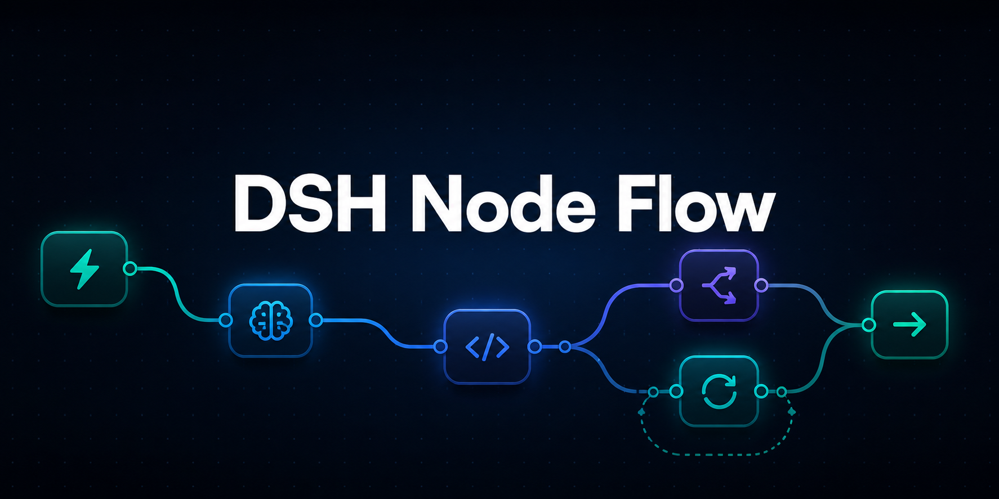
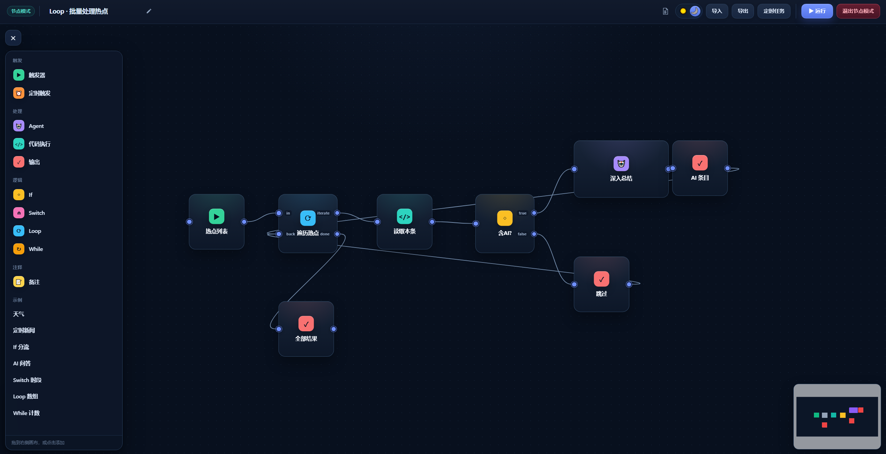
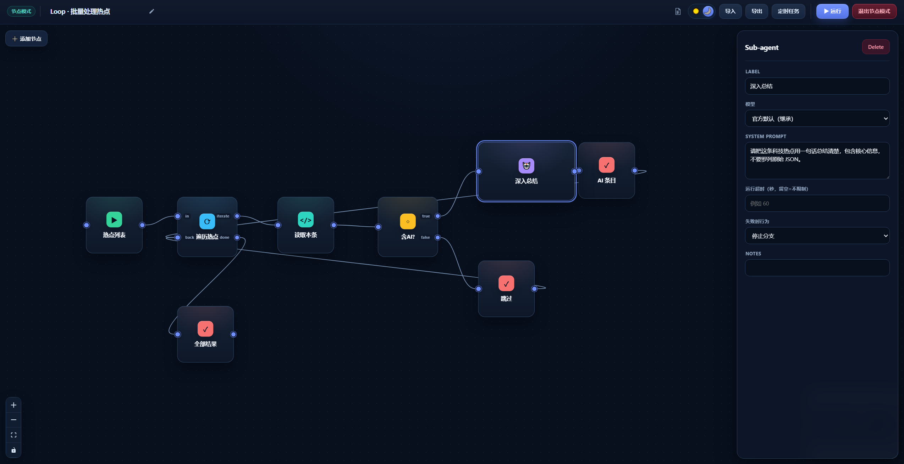
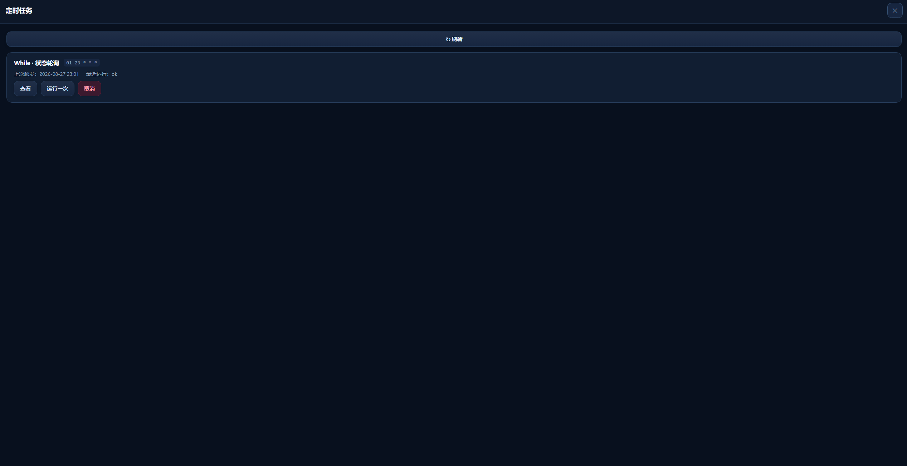

<div align="center">



[English](./README.en.md) · [简体中文](./README.md)

### A visual, executable node-based workflow canvas for DeepSeek Harness

Compose triggers, sub-agents, code, conditional branches, loops, and scheduled tasks with drag-and-drop nodes, then run the complete workflow directly in DSH.

[](./LICENSE)


</div>



<p align="center"><sub>Add nodes from the left palette and arrange the complete workflow on the canvas</sub></p>

## Overview

DSH Node Flow is a visual workflow plugin for [DeepSeek Harness (DSH)](https://github.com/deepseek-ai/deepseek-harness). It combines agent calls, TypeScript / Python code, conditions, and loops into executable flow diagrams, making it easy to build automation tasks and multi-step agent workflows.

## Features

- **Visual orchestration** — drag nodes, connect handles, and inspect data and execution paths directly on the canvas.
- **Sub-agent calls** — agent nodes can inherit the current model or select a model route configured in DSH.
- **Code nodes** — run TypeScript or Python with a full-screen code editor.
- **Flow control** — built-in If, Switch, Loop, and While nodes cover branching and iteration.
- **Execution feedback** — nodes display their run state, and the actual path taken is highlighted.
- **Failure policies** — Code and Agent nodes support timeouts and either stopping the branch or continuing with an empty value.
- **Scheduled tasks** — save workflows with five-field cron expressions, inspect them in the task board, run them immediately, or cancel them.
- **Import and export** — save workflows as files for backup, sharing, and reuse.
- **Built-in documentation** — the help panel explains node fields, connection rules, result semantics, and workflow examples.

## Screenshots

The canvas defines no palette of its own: background, surfaces, text, borders and accent all
come from the host's `--dsw-alias-*` theme tokens, so it matches the shell in both light and
dark and follows a theme change (the screenshots below still show the earlier blue palette and
are kept for layout reference).

### Node properties

Select a node to configure its label, model, prompt, timeout, and failure policy in the right-hand inspector.



### Scheduled tasks

The scheduled-task board displays cron plans, previous trigger times, and latest run results, with actions to inspect, run once, or cancel a task.



## Quick start

### Compatibility

This version targets **DSH 0.2.x** (verified on `0.2.1-rc.2`). The host half uses two
services that replaced earlier seams:

| Capability | Uses | Note |
| --- | --- | --- |
| Code nodes (TypeScript) | `ctx.ptcRuntime` | `ctx.codeRuntime` was removed in 0.2.x; programs run as a `function-body` |
| Agent nodes | `ctx.subagents.startActivation` | `subagents.start()` was removed; the child's result comes back with `delivery: 'caller'` |
| Model dropdown | `ctx.llm.listProviders()` / `listModels()` | `listProviders()` is synchronous in 0.2.x |
| Sidebar entry and canvas | the `main` + `sidebar.panellist` slots | no shell DOM or class names are read any more (`sidebarCol` / `logoRow` no longer exist) |

The minimum host version is declared in `package.json` under `engines.dsh`.

### Installation

Install from a local directory or from Git until the package is published to npm:

```sh
dsh plugin --profile <profile> add /path/to/dsh-workflow-canvas
dsh plugin --profile <profile> add git+https://github.com/CodermanYHZ/dsh-node-flow.git
```

When running DSH from a DeepSeek Harness source checkout, prefix the command with
`pnpm`, for example `pnpm dsh plugin --profile <profile> add <path>`.

Restart the Web UI after installation (`dsh web`; `pnpm dsh web` for a source checkout).

A **Node Mode** icon appears in the DSH sidebar; clicking it opens the canvas in the
central column.

### Diagnostics

On activation the plugin writes a capability snapshot to
`$DSH_HOME/workflow-canvas/health.json`; `selfTest.ok` records whether a real
TypeScript execution succeeded. The same report is served by
`GET /dsh-node-flow/health`. Check it first when a Code node reports an
unavailable runtime.

### Basic usage

1. Click **Add Node**, then choose a node or a built-in example from the left panel.
2. Connect node handles and configure parameters in the right-hand inspector.
3. Click **▶ Run** and watch the node states and highlighted execution path.
4. Use **Export** to save the workflow as a file, or create a cron schedule from **Scheduled Tasks**.

### Execution Workspace and runner session

Agent nodes do not delegate from "whatever agent happens to be live". The **📁 Workspace**
selector in the toolbar decides which Workspace a run belongs to:

- Each Workspace owns one **node-mode runner session**, titled
  `节点模式运行会话 · <workspace>` and listed among that Workspace's sessions.
- The first Agent-node run in a Workspace creates it; later runs reuse it; if it is
  archived or can no longer be revived, the next run creates a fresh one.
- Creation sends one **one-off** bootstrap message (`节点模式运行会话已就绪…`). That is
  not decoration: the sidebar does not render a session that has no messages, and a
  runner session never gains any on its own (children hand their result back to the
  canvas with `delivery: 'caller'`), so without it the row would stay invisible forever.
- Agent nodes execute as children of that session, so they inherit the Workspace's
  directory and sandbox write boundary. That inheritance is the only way to direct a
  child: the host ignores `startActivation`'s `cwd` argument.
- The choice is saved as `executionWorkspaceId` in the workflow document, so export,
  import and scheduled runs all use the same Workspace.

Bindings live in `$DSH_HOME/workflow-canvas/settings.json`; the `runner` section of
`GET /dsh-node-flow/health` reports each Workspace's session id, liveness and visibility.

### Scheduled tasks and run history

A scheduled task does not poll "does the current minute match the cron?". It persists the
**next occurrence** (`nextFireAt`) and a single timer compares that anchor with now:

- The anchor advances and is persisted BEFORE the workflow runs, so a crash costs that one
  run instead of replaying the same occurrence forever.
- An occurrence missed while the host was stopped or the machine asleep is delivered **once**
  on the next wake-up (not N times), then the anchor jumps to the next future time.
- If the previous run of the same task has not settled yet, the new occurrence is skipped and
  logged, so one workflow cannot execute concurrently with itself.
- Every run is stored in `$DSH_HOME/workflow-canvas/runs/<runId>.json` with **its own graph
  snapshot**, each node's status/duration/output/error, and the final output; 30 days and 200
  records are retained, older ones pruned.
- **Manual runs are stored the same way**, so the Scheduled-tasks panel can show every run of
  the workflow and replay any of them on the canvas without touching the graph being edited.

## Companion AI Skill

Install the companion [`dsh-node-flow-skill`](https://github.com/CodermanYHZ/dsh-node-flow-skill) to help AI agents in DSH generate JSON workflows that can be imported directly into this plugin.

The Skill documents the current workflow schema, node fields, connection handles, loop rules, and complete examples, reducing missing fields and invalid handle names. After installation, prompt the AI with:

```text
Use dsh-node-flow-skill to generate an importable dsh-node-flow JSON workflow that …
```

Skill repository: <https://github.com/CodermanYHZ/dsh-node-flow-skill>

## Node types

| Node | Purpose |
| --- | --- |
| **Trigger** | Starts the workflow and passes its content downstream. |
| **Schedule** | Runs the complete workflow using a five-field cron expression. |
| **Agent** | Calls a DSH sub-agent using the inherited model or a selected model route. |
| **Code** | Runs TypeScript or Python on the host, reads upstream input, and returns a result. |
| **If** | Routes the workflow to `true` or `false` based on a truthy condition. |
| **Switch** | Matches a value against cases and falls back to `default`. |
| **Loop** | Iterates over an array or repeats N times, optionally collecting each result. |
| **While** | Repeats while a condition remains true, guarded by `maxIters`. |
| **Output** | Renders the upstream value using a `{{result}}` template. |
| **Note** | Adds a canvas annotation and is not executed. |

## Code node API

TypeScript programs can use the global `dsh` object:

```ts
const response = await dsh.fetch({
  url: "https://example.com/api",
  method: "POST",
  headers: { "Content-Type": "application/json" },
  body: { message: "hello" },
})

const previous = await dsh.input(null) // Read the upstream node output
const now = await dsh.now(null)        // { iso, ts, local }

return response.json
```

Python nodes read upstream input from an environment variable and use standard output as the node result:

```python
import os

previous = os.environ.get("DSH_INPUT", "")
print(previous)
```

> DSH Code Runtime bindings require a lossless JSON argument. Use `dsh.input(null)` and `dsh.now(null)` rather than omitting the argument.

## Runtime requirements

The plugin expects the DSH host to provide these services:

- `ctx.webServer` for the same-origin routes between canvas and host
- `ctx.ptcRuntime` for TypeScript Code nodes (Python runs in a host subprocess)
- `ctx.agents` and `ctx.subagents` for Agent nodes (via `startActivation`)
- `ctx.llm` for the model-route list behind the Agent node's dropdown

The client half needs the `slots` service (`main` and `sidebar.panellist`) and,
optionally, `layout` for the panel's close action.

React, ReactDOM, and `@deepseek-ai/cordis` are provided by DSH as peer dependencies.

## Local development

```sh
npm install
npm run dev       # Start the standalone Vite preview
npm run build     # TypeScript checks + client bundle + demo build
npm test          # Run tests
```

## License

Released under the [MIT License](./LICENSE).
