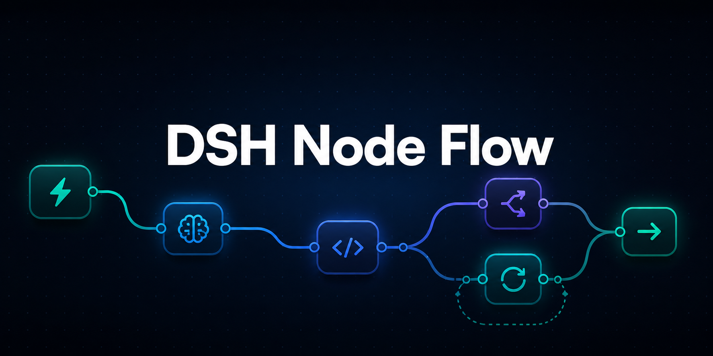
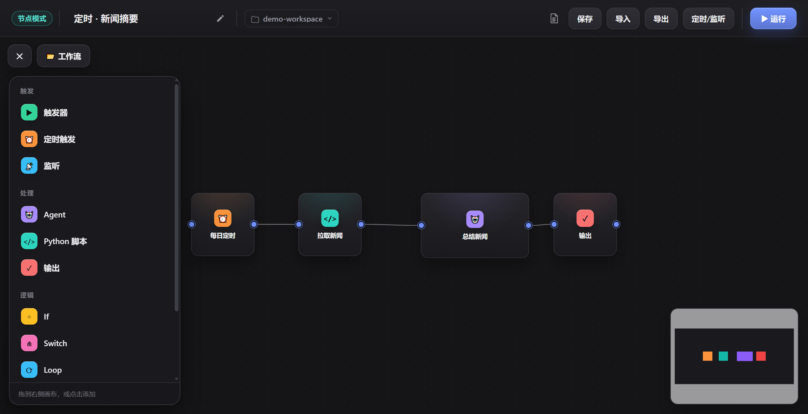
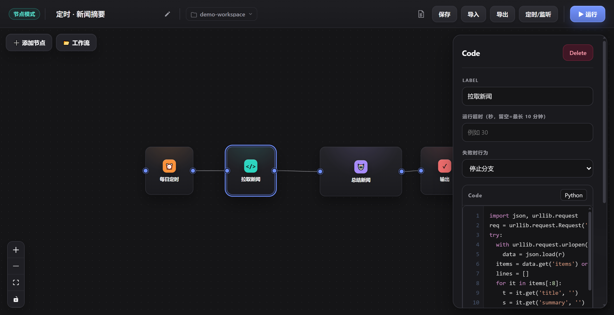
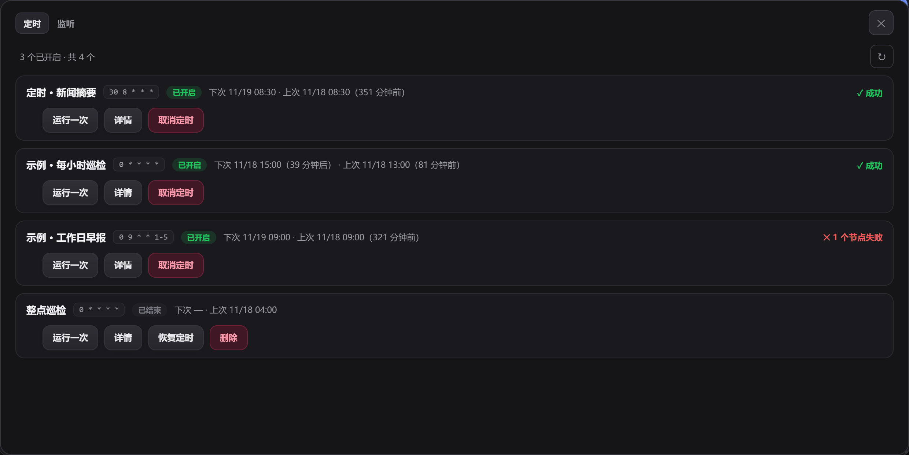

<div align="center">



[English](./README.en.md) · [简体中文](./README.md)

### 为 DeepSeek Harness 提供可视化、可执行的节点工作流画布

用拖拽和连线组织触发器、子 Agent、Python 代码、条件分支、循环、定时与监听，直接在 DSH 中运行完整工作流。

[](./LICENSE)


</div>



<p align="center"><sub>从左侧节点面板添加节点，并在画布中完成拖拽编排</sub></p>

## 项目简介

DSH Node Flow 是一个面向 [DeepSeek Harness（DSH）](https://github.com/deepseek-ai/deepseek-harness) 的可视化工作流插件。它把 Agent 调用、Python 脚本、条件判断、循环控制，以及定时与监听触发，组合成一张可直接执行的流程图，适合快速搭建自动化任务和多步骤 Agent 流程。

## 核心能力

- **可视化编排**：拖拽节点、连接端口，在画布中直观看到数据和执行路径。
- **子 Agent 调用**：Agent 节点可继承当前模型，也可选择 DSH 已配置的模型路由。
- **代码节点（Python）**：在宿主上运行 Python，读上游输入、把 stdout 作为结果，并提供全屏代码编辑器。
- **流程控制**：内置 If、Switch、Loop 和 While，覆盖分支与循环场景。
- **执行反馈**：节点展示运行状态；实际经过的连接路径会高亮，方便定位流程走向。
- **失败策略**：Code / Agent 节点可设置超时、重试次数与间隔，以及“停止分支”或“继续使用空值”。
- **定时任务**：通过 5 段 Cron 表达式保存工作流，在任务面板中查看、立即运行、结束或恢复。
- **监听触发**：监听节点常驻一个 Python 进程，stdout 每行触发一次流程，适合轮询文件、队列或接口。
- **内置示例**：工作流库自带随包发布的示例模板，打开后保存即为自己的新工作流。
- **导入与导出**：工作流可以保存为文件，便于备份、分享和复用。
- **内置文档**：顶部帮助入口按当前实现说明执行模型、节点字段、连线规则与完整示例。

## 界面预览

画布的配色**不自行定义**：底色、面板、文字、描边和强调色全部取自 DSH 主题的 `--dsw-alias-*` 变量，所以它和外壳在深色/浅色下都一致，换主题时也跟着变。

### 节点属性

选中节点后，可以在右侧属性面板配置名称、模型、提示词、超时和失败处理策略。



### 定时任务与监听

定时 / 监听面板集中展示 Cron 计划、上次触发时间、最近运行状态，以及监听进程的日志与事件，并支持立即运行、结束、恢复或删除。



## 快速开始

### 兼容性

本版本面向 **DSH 0.2.x**（`package.json` 的 `engines.dsh` 要求 `>=0.2.0-rc.2`），宿主侧依赖：

| 能力 | 使用方式 | 说明 |
| --- | --- | --- |
| Code 节点 | 宿主 Python 子进程（`python -u -c`） | 输入走环境变量 `DSH_INPUT`，stdout 即节点结果；解释器按 `python → python3 → py` 依次探测 |
| Agent 节点 | `ctx.subagents.startActivation` | 0.2.x 移除了旧的 `subagents.start()`，结果以 `delivery: 'caller'` 交回画布 |
| 模型下拉 | `ctx.llm.listProviders()` / `listModels()` | `listProviders()` 在 0.2.x 为同步返回 |
| 侧边栏入口与画布 | `main` + `sidebar.panellist` 插槽 | 不再读取宿主侧边栏的 DOM 与类名（旧版本依赖的 `sidebarCol` / `logoRow` 已不存在） |

`package.json` 中通过 `engines.dsh` 声明最低版本要求。

### 安装

已发布到 npm 之前，请从本地目录或 Git 仓库安装：

```sh
dsh plugin --profile <profile> add /path/to/dsh-workflow-canvas
dsh plugin --profile <profile> add git+https://github.com/CodermanYHZ/dsh-node-flow.git
```

如果是在 DeepSeek Harness 源码目录中运行 DSH，命令前加 `pnpm`，例如
`pnpm dsh plugin --profile <profile> add <路径>`。

安装完成后重启 Web UI（`dsh web`，源码运行对应 `pnpm dsh web`）。

进入 DSH 后，侧边栏会多出一个 **节点模式** 图标，点击即可在中间栏打开工作流画布。

### 排障

插件激活时会把宿主能力快照写入 `$DSH_HOME/workflow-canvas/health.json`，其中
`selfTest.ok` 表示一次真实的 **Python** 执行是否成功（`selfTest.python` 是解释器版本），
`revision` 是当前加载的插件构建；同样的内容也可通过
`GET /dsh-node-flow/health` 获取。Code 节点报“找不到 Python”时先看这里。

### 基本使用

1. 点击 **添加节点**，从左侧面板选择节点；**📂 工作流** 里可以打开已保存的工作流，以及随插件发布的内置示例。
2. 拖动节点端口建立连接，并在右侧属性面板填写参数。
3. 点击顶部 **▶ 运行**，观察节点状态与实际执行路径。
4. 使用 **导出** 将工作流保存为文件，或通过 **定时任务** 创建 Cron 调度。

内置示例存放在仓库的 `examples/` 目录（随包发布），在工作流库里标记为「内置」并只读：打开后点 **保存** 会另存成一份新工作流，不会写回插件包内的文件。

### 执行工作区与运行会话

Agent 节点不是「随便找个活着的会话」执行。顶栏的 **📁 工作区** 选择器决定这次运行属于哪个工作区：

- 每个工作区对应一个**节点模式运行会话**，标题为「节点模式运行会话 · <工作区名>」，会出现在该工作区的会话列表里。
- 第一次在该工作区运行 Agent 节点时自动创建它；之后复用；如果它被**归档**或不可恢复，下次运行会新建一个并改名。
- 新建时会补一条**一次性**引导消息（「节点模式运行会话已就绪…」）。这不是装饰：侧边栏不渲染没有任何消息的会话，而运行会话本身不会再产生消息（子代理结果按 `delivery: 'caller'` 交回画布），没有这条消息它就会永远不可见。
- Agent 节点作为该会话的子代理执行，因此**继承该工作区的目录与沙箱可写边界**（这是子代理目录的唯一来源：`startActivation` 的 `cwd` 参数会被忽略）。
- 选择结果保存在工作流文档的 `executionWorkspaceId` 里，所以导出、导入和**定时运行**都会用同一个工作区。

绑定关系写入 `$DSH_HOME/workflow-canvas/settings.json`，`GET /dsh-node-flow/health` 的 `runner` 段会显示每个工作区的会话 id、是否存活、是否仍可见。

### 定时任务、监听与运行历史

定时任务不是"每分钟检查 cron 是否命中"，而是**持久化下一次触发时刻**（`nextFireAt`），由单一定时器醒来后比较"锚点 ≤ 现在"：

- 到点触发后**先推进锚点再执行**——中途崩溃只会丢那一次运行，不会重复触发同一次。
- 宿主停机、系统睡眠错过的触发，会在下次醒来时**补跑一次**（不是补 N 次），随后锚点跳到下一个未来时刻。
- 同一个任务上一次还没跑完时，新一次会跳过并在日志里说明，避免并发重复执行。
- cron 按**宿主本地时区**匹配；工作流文档里的 `timezone` 字段目前只存不用。
- 每次运行写入 `$DSH_HOME/workflow-canvas/runs/<runId>.json`：包含**本次的图快照**、每节点状态/耗时/输出/错误、最终输出；保留 30 天 / 200 条，自动清理。
- 定时任务与监听的运行会显示在各自面板下，可以查看节点明细，或「在画布回放」当时的图与结果（回放不会覆盖你正在编辑的画布）。
- 手动运行也会写入 `runs/`，但它不挂在任何定时任务下，所以不会出现在任务列表里。

### 监听触发

监听节点常驻一个 Python 进程，**stdout 每一行是一个事件**，每个事件完整跑一遍流程：

- 以 `[ready]` 开头的行只记录状态，不触发。
- `minIntervalMs`（默认 500ms）内的连发事件合并为最新一条；队列最多 5 条，超出丢弃最旧的。
- 事件串行执行，上一次没跑完不会开下一次；进程退出会让监听变为 error 并停止。
- 在「定时 / 监听」面板里启动、停止、重启或删除；停止会记住状态，宿主重启后尝试恢复。

## 配套 AI Skill

如果希望让 DSH 中的 AI 更准确地生成可直接导入本插件的 JSON 工作流，可以安装配套的 [`dsh-node-flow-skill`](https://github.com/CodermanYHZ/dsh-node-flow-skill)。

该 Skill 包含当前工作流文档结构、节点字段、连线端口、循环规则与完整示例，能够减少字段遗漏或端口名称错误。安装后，可以直接告诉 AI：

```text
使用 dsh-node-flow-skill，为我生成一个可导入 dsh-node-flow 的 JSON 工作流：……
```

Skill 地址：<https://github.com/CodermanYHZ/dsh-node-flow-skill>

## 节点类型

| 节点 | 用途 |
| --- | --- |
| **Trigger** | 工作流入口，将触发内容传递给下游节点。 |
| **Schedule** | 使用 5 段 Cron 表达式定时运行整个工作流。 |
| **Listen** | 常驻 Python 进程，stdout 每一行触发一次工作流。 |
| **Agent** | 调用 DSH 子 Agent，可继承当前模型或指定模型路由。 |
| **Code** | 在宿主运行 Python，读取上游输入（`DSH_INPUT`）并把 stdout 作为结果。 |
| **If** | 根据真值将流程分发到 `true` 或 `false`。 |
| **Switch** | 按值匹配 Case，未命中时进入 `default`。 |
| **Loop** | 遍历数组或重复 N 次，并收集每次循环结果。 |
| **While** | 条件成立时持续循环，并通过 `maxIters` 防止无限执行。 |
| **Output** | 使用 `{{result}}` 模板展示上游结果。 |
| **Note** | 在画布中添加说明，不参与执行。 |

## Code 节点（Python）

Code 节点在宿主上以 `python -u -c <code>` 执行。上游输出通过环境变量 `DSH_INPUT` 传入（非字符串输入会先 JSON 序列化），**stdout 去掉首尾空白后整段就是节点结果**：

```python
import json, os

raw = os.environ.get("DSH_INPUT", "")   # 上游节点的输出
print(json.dumps({"length": len(raw)}, ensure_ascii=False))
```

- 只有进程非 0 退出或超时才算失败；失败信息取 stderr（退出码为 0 时 stderr 不影响结果）。
- 超时由节点的 `timeout`（秒）控制，另有 600 秒硬上限。
- 旧文档里的 `language` 字段会被忽略，一律按 Python 执行。

节点字段、端口名称与表达式写法的完整说明在应用内 **📖 使用文档** 中，以那一份为准。

## 运行环境

插件依赖 DSH 宿主提供以下服务：

- `ctx.webServer`（画布与宿主之间的同源 HTTP 路由）
- 宿主 PATH 上的 Python 解释器（Code 与监听节点，按 `python → python3 → py` 依次探测）
- `ctx.agents` 与 `ctx.subagents`（Agent 节点，使用 `startActivation`）
- `ctx.llm`（模型路由列表，用于 Agent 节点的模型下拉）

客户端半边依赖 `slots` 服务（`main` 与 `sidebar.panellist` 插槽）与可选的 `layout`（关闭按钮）。

React、ReactDOM 和 `@deepseek-ai/cordis` 由 DSH 作为 Peer Dependencies 提供。

## 本地开发

```sh
npm install
npm run dev       # 启动独立 Vite 预览
npm run build     # TypeScript 检查 + 客户端打包 + Demo 构建
```

内置示例是 `examples/*.json`（工作流文档），改完直接生效，不需要重新生成代码；新增示例只需加一个 JSON 文件。

## 许可证

本项目基于 [MIT License](./LICENSE) 开源。
