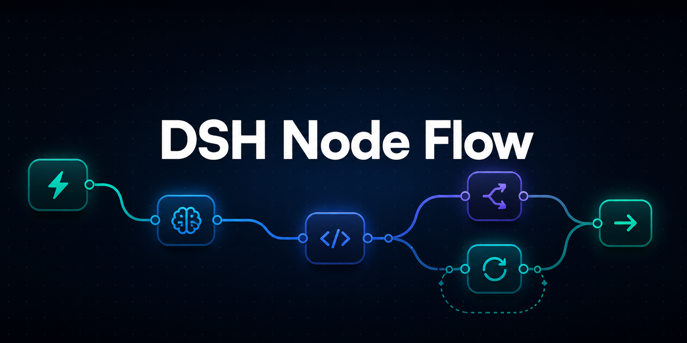
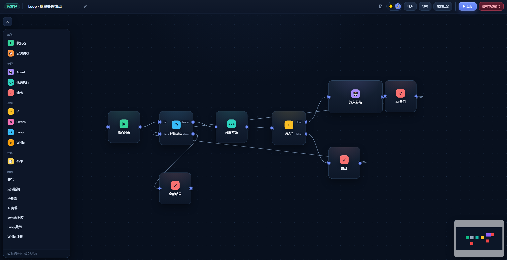
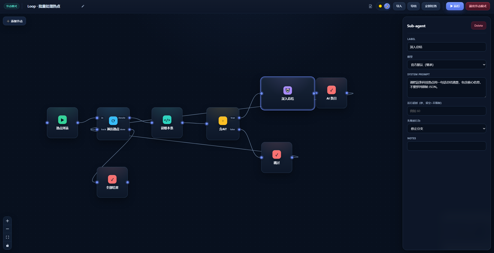
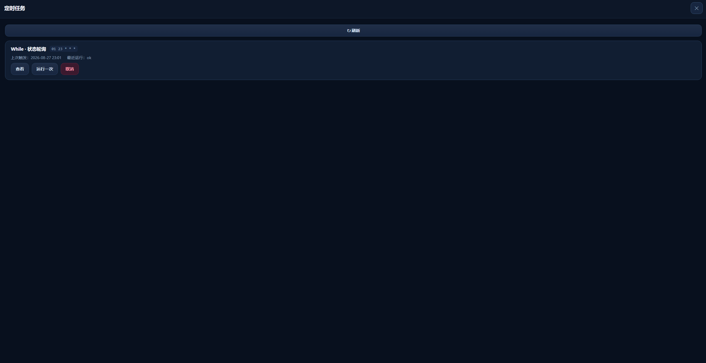

<div align="center">



[English](./README.en.md) · [简体中文](./README.md)

### 为 DeepSeek Harness 提供可视化、可执行的节点工作流画布

用拖拽和连线组织触发器、子 Agent、代码、条件分支、循环与定时任务，直接在 DSH 中运行完整工作流。

[](./LICENSE)


</div>



<p align="center"><sub>从左侧节点面板添加节点，并在画布中完成拖拽编排</sub></p>

## 项目简介

DSH Node Flow 是一个面向 [DeepSeek Harness（DSH）](https://github.com/deepseek-ai/deepseek-harness) 的可视化工作流插件。它把 Agent 调用、TypeScript / Python 代码、条件判断和循环控制组合成一张可直接执行的流程图，适合快速搭建自动化任务和多步骤 Agent 流程。

## 核心能力

- **可视化编排**：拖拽节点、连接端口，在画布中直观看到数据和执行路径。
- **子 Agent 调用**：Agent 节点可继承当前模型，也可选择 DSH 已配置的模型路由。
- **代码节点**：支持 TypeScript 与 Python，并提供全屏代码编辑器。
- **流程控制**：内置 If、Switch、Loop 和 While，覆盖分支与循环场景。
- **执行反馈**：节点展示运行状态；实际经过的连接路径会高亮，方便定位流程走向。
- **失败策略**：Code / Agent 节点可设置超时，以及“停止分支”或“继续使用空值”。
- **定时任务**：通过 5 段 Cron 表达式保存工作流，在任务面板中查看、立即运行或取消。
- **导入与导出**：工作流可以保存为文件，便于备份、分享和复用。
- **内置文档**：顶部帮助入口包含节点字段、连线规则、结果语义和工作流示例。

## 界面预览

画布的配色**不自行定义**：底色、面板、文字、描边和强调色全部取自 DSH 主题的 `--dsw-alias-*` 变量，所以它和外壳在深色/浅色下都一致，换主题时也跟着变（下图是早期蓝色配色，仅供参考布局）。

### 节点属性

选中节点后，可以在右侧属性面板配置名称、模型、提示词、超时和失败处理策略。



### 定时任务

定时任务面板集中展示 Cron 计划、上次触发时间和最近运行状态，并支持查看、立即运行或取消任务。



## 快速开始

### 兼容性

本版本面向 **DSH 0.2.x**（在 `0.2.1-rc.2` 上验证），宿主侧使用两个新服务：

| 能力 | 使用方式 | 说明 |
| --- | --- | --- |
| Code 节点（TypeScript） | `ctx.ptcRuntime` | 0.2.x 移除了旧的 `ctx.codeRuntime`，程序按 `function-body` 形式执行 |
| Agent 节点 | `ctx.subagents.startActivation` | 0.2.x 移除了旧的 `subagents.start()`，结果以 `delivery: 'caller'` 交回画布 |
| 模型下拉 | `ctx.llm.listProviders()` / `listModels()` | `listProviders()` 在 0.2.x 为同步返回 |
| 侧边栏入口与画布 | `main` + `sidebar.panellist` 插槽 | 不再读取宿主侧边栏的 DOM 与类名（旧版本依赖的 `sidebarCol` / `logoRow` 已不存在） |

`package.json` 中通过 `engines.dsh` 声明最低版本要求。

### 安装

已发布到 npm 之前，请从本地目录或 Git 仓库安装：

```sh
dsh plugin --profile <profile> add /path/to/dsh-workflow-canvas
dsh plugin --profile <profile> add git+https://github.com/CodermanYHZ/dsh-node-flow.git
```

如果是在 DeepSeek Harness 源码目录中运行 DSH，命令前加 `pnpm`，例如
`pnpm dsh plugin --profile <profile> add <路径>`。

安装完成后重启 Web UI（`dsh web`，源码运行对应 `pnpm dsh web`）。

进入 DSH 后，侧边栏会多出一个 **节点模式** 图标，点击即可在中间栏打开工作流画布。

### 排障

插件激活时会把宿主能力快照写入 `$DSH_HOME/workflow-canvas/health.json`，其中
`selfTest.ok` 表示一次真实的 TypeScript 执行是否成功；同样的内容也可通过
`GET /dsh-node-flow/health` 获取。Code 节点报“运行时不可用”时先看这里。

### 基本使用

1. 点击 **添加节点**，从左侧面板选择节点或内置示例。
2. 拖动节点端口建立连接，并在右侧属性面板填写参数。
3. 点击顶部 **▶ 运行**，观察节点状态与实际执行路径。
4. 使用 **导出** 将工作流保存为文件，或通过 **定时任务** 创建 Cron 调度。

### 执行工作区与运行会话

Agent 节点不是「随便找个活着的会话」执行。顶栏的 **📁 工作区** 选择器决定这次运行属于哪个工作区：

- 每个工作区对应一个**节点模式运行会话**，标题为「节点模式运行会话 · <工作区名>」，会出现在该工作区的会话列表里。
- 第一次在该工作区运行 Agent 节点时自动创建它；之后复用；如果它被**归档**或不可恢复，下次运行会新建一个并改名。
- 新建时会补一条**一次性**引导消息（「节点模式运行会话已就绪…」）。这不是装饰：侧边栏不渲染没有任何消息的会话，而运行会话本身不会再产生消息（子代理结果按 `delivery: 'caller'` 交回画布），没有这条消息它就会永远不可见。
- Agent 节点作为该会话的子代理执行，因此**继承该工作区的目录与沙箱可写边界**（这是子代理目录的唯一来源：`startActivation` 的 `cwd` 参数会被忽略）。
- 选择结果保存在工作流文档的 `executionWorkspaceId` 里，所以导出、导入和**定时运行**都会用同一个工作区。

绑定关系写入 `$DSH_HOME/workflow-canvas/settings.json`，`GET /dsh-node-flow/health` 的 `runner` 段会显示每个工作区的会话 id、是否存活、是否仍可见。

### 定时任务与运行历史

定时任务不是"每分钟检查 cron 是否命中"，而是**持久化下一次触发时刻**（`nextFireAt`），由单一定时器醒来后比较"锚点 ≤ 现在"：

- 到点触发后**先推进锚点再执行**——中途崩溃只会丢那一次运行，不会重复触发同一次。
- 宿主停机、系统睡眠错过的触发，会在下次醒来时**补跑一次**（不是补 N 次），随后锚点跳到下一个未来时刻。
- 同一个任务上一次还没跑完时，新一次会跳过并在日志里说明，避免并发重复执行。
- 每次运行写入 `$DSH_HOME/workflow-canvas/runs/<runId>.json`：包含**本次的图快照**、每节点状态/耗时/输出/错误、最终输出；保留 30 天 / 200 条，自动清理。
- **手动运行同样入库**，所以在「定时任务」面板里可以回看这个工作流的每一次运行，并用「在画布回放」还原当时的图与结果（回放不会覆盖你正在编辑的画布）。

## 配套 AI Skill

如果希望让 DSH 中的 AI 更准确地生成可直接导入本插件的 JSON 工作流，可以安装配套的 [`dsh-node-flow-skill`](https://github.com/CodermanYHZ/dsh-node-flow-skill)。

该 Skill 包含当前工作流文档结构、节点字段、连线端口、循环规则与完整示例，能够减少字段遗漏或端口名称错误。安装后，可以直接告诉 AI：

```text
使用 dsh-node-flow-skill，为我生成一个可导入 dsh-node-flow 的 JSON 工作流：……
```

Skill 地址：<https://github.com/CodermanYHZ/dsh-node-flow-skill>

## 节点类型

| 节点 | 用途 |
| --- | --- |
| **Trigger** | 工作流入口，将触发内容传递给下游节点。 |
| **Schedule** | 使用 5 段 Cron 表达式定时运行整个工作流。 |
| **Agent** | 调用 DSH 子 Agent，可继承当前模型或指定模型路由。 |
| **Code** | 在宿主运行 TypeScript 或 Python，读取上游输入并返回结果。 |
| **If** | 根据真值将流程分发到 `true` 或 `false`。 |
| **Switch** | 按值匹配 Case，未命中时进入 `default`。 |
| **Loop** | 遍历数组或重复 N 次，并收集每次循环结果。 |
| **While** | 条件成立时持续循环，并通过 `maxIters` 防止无限执行。 |
| **Output** | 使用 `{{result}}` 模板展示上游结果。 |
| **Note** | 在画布中添加说明，不参与执行。 |

## Code 节点 API

TypeScript 代码中可使用全局 `dsh` 对象：

```ts
const response = await dsh.fetch({
  url: "https://example.com/api",
  method: "POST",
  headers: { "Content-Type": "application/json" },
  body: { message: "hello" },
})

const previous = await dsh.input(null) // 读取上游节点输出
const now = await dsh.now(null)        // { iso, ts, local }

return response.json
```

Python 节点通过环境变量读取上游结果，并将标准输出作为节点结果：

```python
import os

previous = os.environ.get("DSH_INPUT", "")
print(previous)
```

> PTC 运行时的绑定调用必须传入可无损 JSON 序列化的参数，因此应写成 `dsh.input(null)` 和 `dsh.now(null)`，不能省略参数。

## 运行环境

插件依赖 DSH 宿主提供以下服务：

- `ctx.webServer`（画布与宿主之间的同源 HTTP 路由）
- `ctx.ptcRuntime`（Code 节点的 TypeScript 执行；Python 走宿主子进程）
- `ctx.agents` 与 `ctx.subagents`（Agent 节点，使用 `startActivation`）
- `ctx.llm`（模型路由列表，用于 Agent 节点的模型下拉）

客户端半边依赖 `slots` 服务（`main` 与 `sidebar.panellist` 插槽）与可选的 `layout`（关闭按钮）。

React、ReactDOM 和 `@deepseek-ai/cordis` 由 DSH 作为 Peer Dependencies 提供。

## 本地开发

```sh
npm install
npm run dev       # 启动独立 Vite 预览
npm run build     # TypeScript 检查 + 客户端打包 + Demo 构建
npm test          # 运行测试
```

## 许可证

本项目基于 [MIT License](./LICENSE) 开源。
